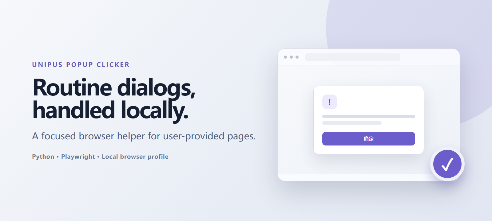
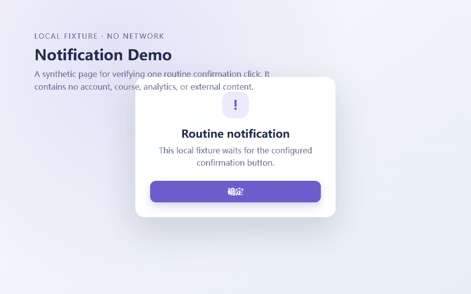
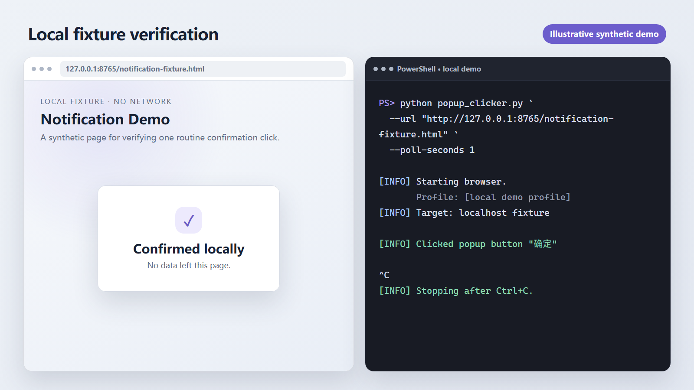

# Unipus Popup Clicker

> A small local Playwright utility that watches a page you provide and clicks a matching routine notification button when it appears.
>
> 一个在本地运行的 Playwright 小工具：监视你提供的页面，并在匹配的常规通知按钮出现时自动点击。



## What it does / 功能说明

The utility opens a user-provided URL in a local Chromium window, searches the page and its frames for a visible button whose text matches `--button-text`, and clicks the first match. It checks again at the configured interval until you stop it with <kbd>Ctrl</kbd>+<kbd>C</kbd>.

工具会在本地 Chromium 窗口中打开你提供的网址，在页面及其内嵌框架中查找文字与 `--button-text` 匹配的可见按钮，点击第一个匹配项，并按设定间隔持续检查，直到你按 <kbd>Ctrl</kbd>+<kbd>C</kbd> 停止。

If the site requires authentication, sign in manually in the visible browser. The program does not ask for or store your password.

如果网站要求登录，请在打开的浏览器窗口中手动完成。程序不会索取或保存你的密码。

## Demo / 演示

The demo uses the repository's fully local [notification fixture](docs/assets/demo/notification-fixture.html). It contains synthetic text and one `确定` button; it has no login, analytics, external assets, or network requests.

演示使用仓库内完全本地的[通知测试页面](docs/assets/demo/notification-fixture.html)。页面仅含合成文案和一个“确定”按钮，不包含登录、分析、外部资源或网络请求。



> **Illustrative synthetic demo / 说明性合成演示：** The image below is a designed illustration of the verified localhost run, not a literal screen capture. / 下图是根据已验证的本地运行结果制作的说明性合成图，并非真实屏幕截图。



## Safety and intended use / 安全与使用边界

This project is intended only for confirming routine notification dialogs on pages you are authorized to use. It is not affiliated with, endorsed by, or maintained by Unipus.

本项目仅用于确认你有权使用的页面中的常规通知弹窗，与 Unipus 无隶属、认可或维护关系。

You are responsible for following the site's rules and your course or institution requirements. Do not use this utility to bypass attendance, required learning time, assessments, access controls, anti-bot measures, or any other obligation or safeguard.

你有责任遵守网站规则以及课程或机构要求。请勿使用本工具绕过考勤、规定学习时长、测评、访问控制、反自动化措施，或任何其他义务与安全机制。

Because matching is text-based, choose a specific button label and verify the target page before leaving the utility running.

由于工具按文字匹配按钮，请使用明确的按钮文字，并在持续运行前确认目标页面无误。

## Windows quick start / Windows 快速开始

Requirements: Windows, Python 3.10 or newer, and an internet connection for the one-time dependency/browser installation.

环境要求：Windows、Python 3.10 或更高版本；首次安装依赖和浏览器时需要联网。

1. Clone or download this repository.
2. Double-click `setup_windows.bat`. It creates `.venv`, installs dependencies and Chromium, and runs the tests.
3. Open PowerShell in the project folder and start the utility with a page you are authorized to use:

   ```powershell
   .\.venv\Scripts\python.exe popup_clicker.py --url "https://example.com/your-page"
   ```

4. If prompted, sign in manually in the browser window.
5. Keep the browser and PowerShell windows open. Press <kbd>Ctrl</kbd>+<kbd>C</kbd> in PowerShell to stop.

中文步骤：

1. 克隆或下载本仓库。
2. 双击 `setup_windows.bat`，创建 `.venv`、安装依赖与 Chromium，并运行测试。
3. 在项目目录打开 PowerShell，使用上方命令传入你有权访问的页面网址。
4. 如网站要求登录，请在浏览器窗口中手动完成。
5. 保持浏览器和 PowerShell 窗口打开；在 PowerShell 中按 <kbd>Ctrl</kbd>+<kbd>C</kbd> 停止。

`run_windows.bat` prompts for an explicit page URL and passes it to the utility. The script will not start without one.

`run_windows.bat` 会提示你明确输入页面网址，再将其传给工具；未输入网址时不会启动。

## Command-line usage / 命令行使用

Install manually when you do not use the setup script:

不使用安装脚本时，可通过以下命令手动安装：

```powershell
python -m venv .venv
.\.venv\Scripts\python.exe -m pip install -r requirements.txt
.\.venv\Scripts\python.exe -m playwright install chromium
```

Run with an explicit URL and, if needed, a different notification label:

运行时请明确传入网址；如有需要，也可指定不同的通知按钮文字：

```powershell
.\.venv\Scripts\python.exe popup_clicker.py `
  --url "https://example.com/your-page" `
  --button-text "确定" `
  --poll-seconds 5
```

Show the built-in help:

查看内置帮助：

```powershell
.\.venv\Scripts\python.exe popup_clicker.py --help
```

## Options / 参数

| Option / 参数 | Meaning / 说明 | Default / 默认值 |
| --- | --- | --- |
| `--url` | Page to open and monitor; pass a page you are authorized to use. This option is required. / 要打开并监视的页面；请传入你有权使用的页面。此参数为必填。 | Required / 必填 |
| `--button-text` | Visible text used to match the routine notification button. Fallback selectors may match elements containing this text, so choose a sufficiently specific label. / 用于匹配常规通知按钮的可见文字。备用选择器可能匹配包含该文字的元素，因此请使用足够明确的标签。 | `确定` |
| `--poll-seconds` | Seconds between checks; must be at least `1`. / 两次检查之间的秒数，最小为 `1`。 | `5` |
| `--profile-dir` | Local persistent Chromium profile directory. / Chromium 本地持久化配置目录。 | `.browser-profile` |
| `--log-dir` | Local directory for `popup_clicker.log`. / `popup_clicker.log` 的本地目录。 | `logs` |
| `--headless` | Run Chromium without a visible window; manual login is unavailable in this mode. / 不显示窗口运行 Chromium；此模式下无法手动登录。 | Off / 关闭 |

## Local data and privacy / 本地数据与隐私

By default, all runtime state stays on your computer:

- `.browser-profile/` contains the persistent Chromium profile and may include sensitive session data such as cookies. Treat it as private.
- `logs/popup_clicker.log` records startup, target URL, clicks, warnings, and shutdown messages.
- `.venv/`, `.pytest_cache/`, and `__pycache__/` contain local dependencies or generated caches.

These paths are excluded by `.gitignore`. Do not upload, share, or commit local profiles, logs, cookies, or credentials. The fixture and screenshots in this repository use synthetic data only.

默认情况下，运行状态只保存在你的电脑上。`.browser-profile/` 可能包含 Cookie 等敏感会话数据，`logs/` 会记录目标网址与运行事件；这些目录已被 `.gitignore` 排除。请勿上传或分享本地配置、日志、Cookie 或凭据。

## Testing / 测试

Run the unit tests:

运行单元测试：

```powershell
.\.venv\Scripts\python.exe -m pytest -q
```

For a safe manual check, serve the synthetic fixture locally:

如需安全地手动检查，请先在本地启动合成测试页面：

```powershell
.\.venv\Scripts\python.exe -m http.server 8765 --directory docs/assets/demo
```

In a second PowerShell window:

然后在第二个 PowerShell 窗口中运行：

```powershell
.\.venv\Scripts\python.exe popup_clicker.py `
  --url "http://127.0.0.1:8765/notification-fixture.html" `
  --poll-seconds 1 `
  --profile-dir ".browser-profile/demo" `
  --log-dir "logs/demo"
```

The dialog should change to `Confirmed locally` after the utility clicks `确定`. Stop both processes with <kbd>Ctrl</kbd>+<kbd>C</kbd>, then delete the temporary demo profile and logs if desired.

工具点击“确定”后，页面应显示 `Confirmed locally`。在两个窗口中按 <kbd>Ctrl</kbd>+<kbd>C</kbd> 停止进程；如有需要，可随后删除临时演示配置与日志。

## Troubleshooting / 常见问题

- **Chromium is missing / 缺少 Chromium：** run `.\.venv\Scripts\python.exe -m playwright install chromium`. / 运行该命令安装 Chromium。
- **`--url` is required / 必须提供 `--url`：** pass the authorized page explicitly, or use `run_windows.bat` and enter it when prompted. / 请明确传入有权使用的页面，或运行 `run_windows.bat` 并按提示输入。
- **The button is not clicked / 按钮未被点击：** confirm that the desired visible label is present, sufficiently specific for `--button-text`, and actually visible. / 确认目标文字存在、对 `--button-text` 而言足够明确，并且按钮确实可见。
- **Login is required / 需要登录：** omit `--headless` and complete login manually in the opened browser. / 不要使用 `--headless`，并在打开的浏览器中手动登录。
- **The wrong button could match / 可能匹配错误按钮：** stop the utility, choose a more specific label, and verify the page before restarting. / 停止工具，改用更明确的标签，并在重启前核对页面。
- **`poll_seconds must be at least 1 second`：** use `--poll-seconds 1` or a larger value. / 将 `--poll-seconds` 设为 `1` 或更大。
- **A stale session causes problems / 旧会话导致问题：** stop the utility and move or remove the chosen profile directory only after confirming you no longer need its local session. / 停止工具，并确认不再需要本地会话后，再移动或删除对应配置目录。

## License

Released under the [MIT License](LICENSE). Copyright © 2026 Xiaotian69.
